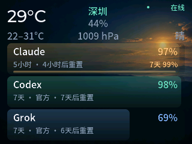

# xiaobucubic

运行在 ClocTeck HoloCubic Lua 固件上的 320×240 信息显示应用：订阅剩余额度、天气和提醒。



- 主页显示 Claude、Codex、Grok 剩余额度；Claude 同时显示两个用量窗口。
- 额度卡片使用半透明渐变，低于 20% 显示黄色，低于 5% 显示红色。
- 天气背景随预报变化，显示温度、湿度和气压。
- 有有效提醒时轮播消息页，过期消息自动退出；消息正文使用大字号并自动换行。
- 支持局部刷新、离线缓存和自动重连，持续失败时最多每 5 分钟重试。

## 项目内容

应用及本次开发的资源、文档、测试和工具均在 [`apps/xiaobucubic/`](apps/xiaobucubic/) 中：

| 目录 | 内容 |
|---|---|
| `package/` | 可安装的 Lua 应用、字体及天气图片 |
| `assets/` | 天气背景原图及生成说明 |
| `examples/` | 接口示例数据 |
| `tests/` | 模型、生命周期及实机验证脚本 |
| `tools/` | 打包、部署和接口调试工具 |
| `preview/` | 实机界面截图 |

## 文档

- [安装、配置与操作](apps/xiaobucubic/README.md)
- [服务端读取接口](apps/xiaobucubic/API.md)
- [验证记录](apps/xiaobucubic/VALIDATION.md)
- [第三方资源与字体许可](apps/xiaobucubic/THIRD_PARTY.md)

## 测试与打包

```sh
cd apps/xiaobucubic
uv run --with lupa python tests/test_display.py
python3 -m unittest discover -s tests -p 'test_mock_api.py'
python3 tools/build.py
```

安装包生成于 `apps/xiaobucubic/dist/`。设备凭证、缓存、备份和打包产物均不会提交到仓库。

项目保留 [GPL-3.0 许可证](LICENSE)；字体的独立许可随应用附带。
