# HP 指标与周限算法（现行实现）

2026-11-26 · 对应代码：`server/hp_model.py`（日 HP）、`server/hp_weekly.py`（周限）、`server/hp_usage.py`（采集与组装）、`server/display_server.py`（投影为卡片）。

本文只描述**当前代码实际怎么算**，参数值均取自代码默认值（`DEFAULT_PARAMS`，可用 `hp_usage.py --params FILE` 覆盖）。设计动机与取舍见 `docs/hp-algorithm-design.md` 和 `docs/superpowers/specs/2026-11-25-hp-weekly-limit-design.md`。

---

## 两条公式（一句话版本）

后面各节把这两条展开。为了贴近代码，每条里各保留一处递推：日 HP 每 5 分钟截断到 0–100，周限账本的结余不能为负。

### 公式一：日 HP

$$
HP(t)=
\begin{cases}
\operatorname{clamp}_{[0,100]}\!\left(HP_0-\displaystyle\int_{t_0}^{t}\big(b+L(u)-G(u)\big)\,du\right) & \text{醒着}\\[2ex]
HP_{\text{bed}}+\big(\bar A-HP_{\text{bed}}\big)^{+}\cdot\min\!\left(1,\ \dfrac{1-e^{-s/\tau}}{1-e^{-H/\tau}}\right) & \text{睡着}
\end{cases}
\qquad
HP_0=\operatorname{clamp}_{[20,100]}\big(40+1.5\,(r-50)\big)
$$

| 符号 | 含义 | 值 |
|---|---|---|
| $t_0$ | 主睡眠醒来时刻 | |
| $r$ | Oura 准备度（缺失时改用睡眠、HRV、静息心率估算，见第 2 节） | |
| $b$ | 清醒基础消耗 | 2 %/h |
| $L(u)$ | 当下负荷： 运动 $9\,x\,a\,e^{b'x}$，$x=\frac{HR-RHR}{HR_{max}-RHR}$ 压力 $\min\big(8,\ 20\,(e-0.08)^{+}\big)$，$e=\frac{HR-HR_{quiet}}{HR_{quiet}}$ 无数据或未佩戴 0.8 | %/h |
| $G(u)$ | 静息（$e\le-0.05$）时为 2，正好抵消 $b$；其它时候为 0 | %/h |
| $HP_{\text{bed}}$ | 入睡时的 HP | |
| $\bar A$ | 近 28 天 $HP_0$ 的中位数 | |
| $s$ | 已睡小时数 | |
| $H$ | 习惯睡眠时长 | |
| $\tau$ | 回血时间常数 | 4.2 h |

小睡用同一个指数式一次性回血，目标值换成当天的 $HP_0$。积分在代码里按 5 分钟一格离散，每格都截断到 0–100。

### 公式二：周限

$$
W=100\cdot\operatorname{clamp}_{[0,1]}\!\left(1-\frac{B_N+E}{7}\right),
\qquad
B_d=\big(B_{d-1}+D_d-C_d\big)^{+},\quad B_0=0
$$

$$
\begin{aligned}
D_d&=(7-h_d)^{+}+0.25\,\ell_d+\frac{0.5\,(m_d-60)^{+}}{60}+0.25\,\mathbf{1}[\text{steps}_d<5000]+\mathbf{1}[\text{恢复不良}_d]+0.5\,T_d(HP<20)\\
C_d&=\big(\min(h_d,9)-7\big)^{+}+0.25\,T_d(\text{rest})\\
E&=\min\!\left(2.5,\ \frac{(150\,p-M)^{+}}{60}\right)+\frac{(Q-300)^{+}}{60}
\end{aligned}
$$

| 符号 | 含义 |
|---|---|
| $W$ | 周剩余 %，从周六 12:00 起算；＜20 黄色，＜5 红色 |
| $B_d$ | 第 $d$ 天结束时的负债结余（小时），$N$ 为本周最后一天 |
| $D_d$ / $C_d$ | 当天负债 / 还款（小时） |
| $h_d$ | 当夜睡眠小时数（主睡眠 + 同日小睡） |
| $\ell_d$ | 入睡晚于 00:00 的小时数 |
| $m_d$ | Oura 高压力分钟数 |
| 恢复不良 | $z_{HRV}\le-1$，或 $z_{RHR}\ge1$ 且静息心率比基线高 ≥3 bpm |
| $T_d(\cdot)$ | 当天处于该状态的小时数，来自公式一的 5 分钟格 |
| $M$ | 中强度当量分钟 = 中强度分钟 + 2 × 高强度分钟 |
| $Q$ | 本周高强度分钟 |
| $p$ | 周进度 = 本周已过时间 ÷ 7 天，取 0–1 |

$(x)^{+}=\max(0,x)$，$\mathbf{1}[\cdot]$ 在条件成立时为 1、否则为 0。两条公式通过 $T_d(HP<20)$ 和 $T_d(\text{rest})$ 相连：白天透支和静息的时长直接计入周负债和还款。

---

## 0. 总览

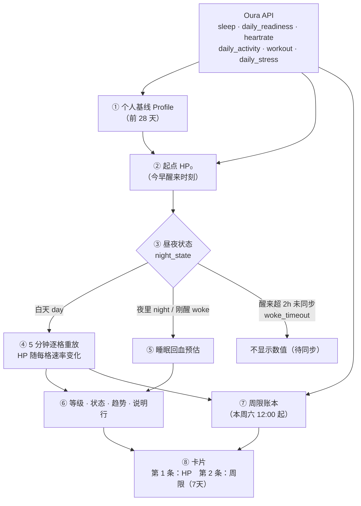

---

## 1. 个人基线 Profile

取锚点日**之前 28 天**里有主睡眠（`long_sleep`，每天取时长最长的一段）的日子，`valid_days` = 天数。

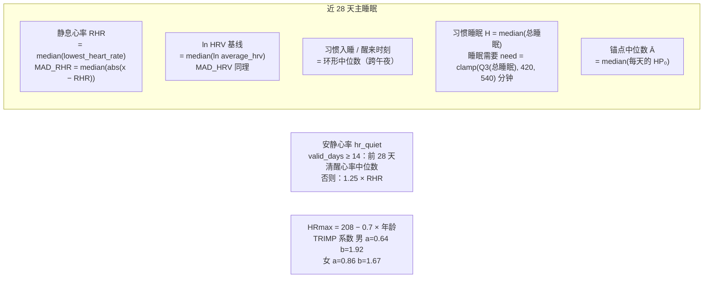

**稳健 z 分数**（基线缺失或 MAD = 0 时取 0）：

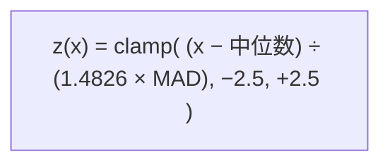

`z_HRV` 用 `ln(average_hrv)`，`z_RHR` 用 `lowest_heart_rate`。

---

## 2. 起点 HP₀（锚点）

锚点日：今天的主睡眠已结束就用今天，否则用昨天；都没有则不显示。`t₀` = 主睡眠醒来时刻（`bedtime_end`）。

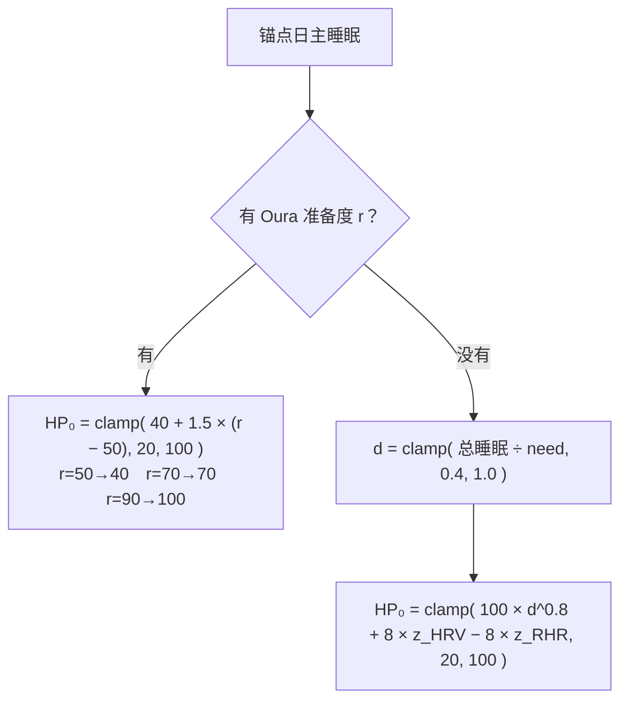

---

## 3. 白天：5 分钟逐格重放

从 `t₀` 到现在，按 5 分钟一格依次累加。速率 `rate` 的单位是 **%/h**：

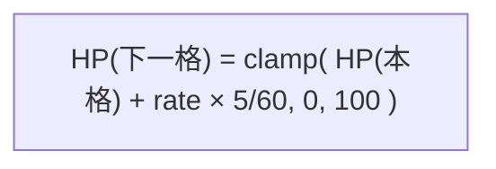

基础消耗 `basal = 2 %/h`（× κ，κ = 1）。每格按下图**从上到下**判定类型：

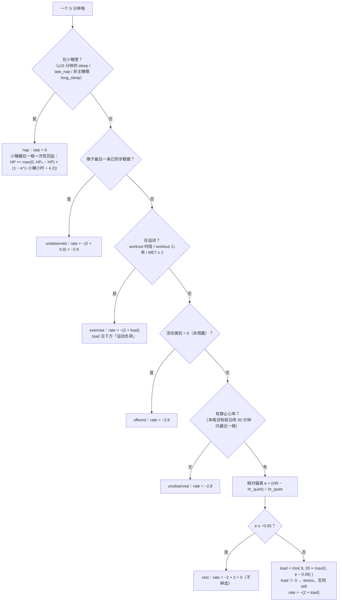

**运动负荷 load**（按可用数据择一）：

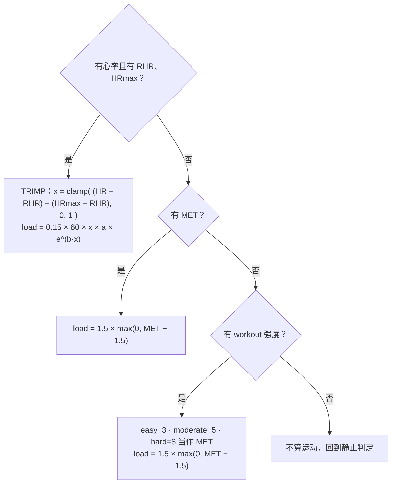

速率参考：静止 −2 %/h；心率高出安静心率 18% 时 stress 约 −4 %/h，封顶 −10 %/h；男性心率储备 50% 时 TRIMP 约 −9.5 %/h。

---

## 4. 夜间：入睡判定与睡眠回血预估

只看锚点日 18:00 之后的心率。

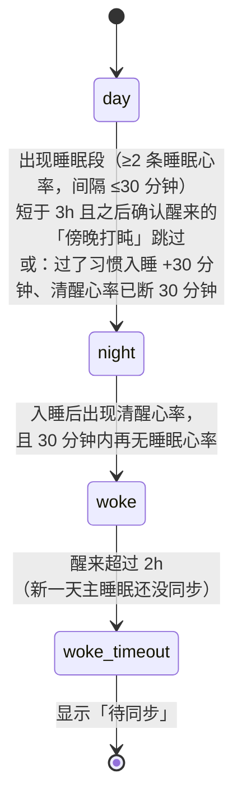

入睡前的 HP 记为 `HP_bed`（重放到入睡时刻）。睡眠中按指数回血，回到 Ā：

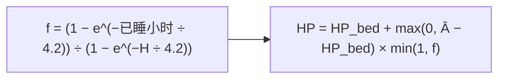

- `H` 是习惯睡眠时长；睡满 H 就恢复到 Ā。
- `Ā` 是锚点中位数，没有时用 HP₀。
- `night` 状态的「已睡小时」算到现在，`woke` 状态算到醒来时刻。
- 说明行固定为「睡眠预估」。

---

## 5. 输出：等级、状态、趋势、说明行

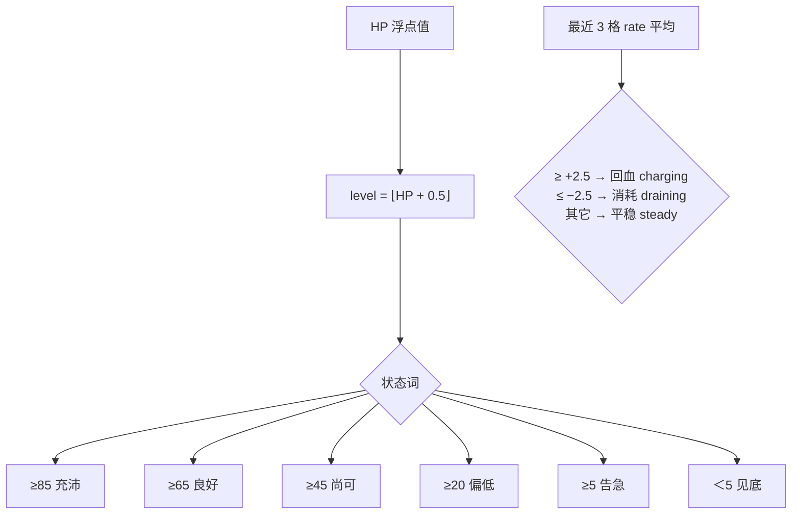

**不显示数值（待同步）** 的情况：

- 白天最后一次同步距今 ≥ 8h；
- 已过习惯醒来时刻 2h，且锚点醒来已超过 20h（新一天的睡眠还没同步）；
- 醒来超过 2h（`woke_timeout`）。

**说明 note**：按优先级取第一条命中的。

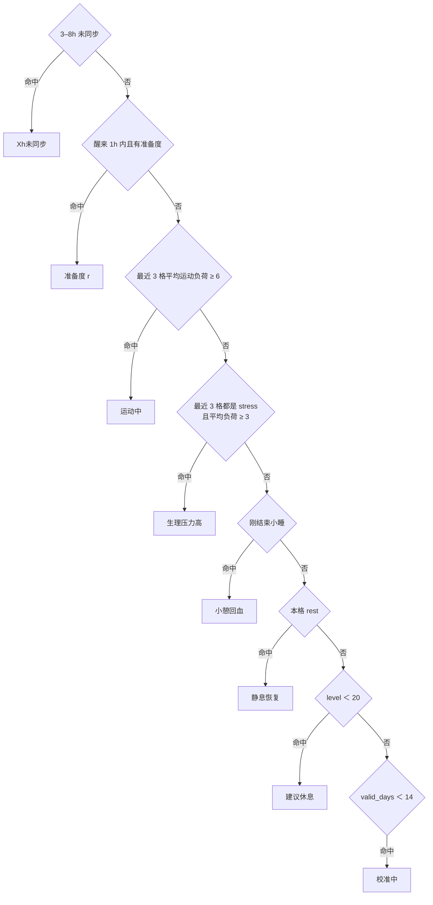

**卡片说明行 line**（白天，≤16 字，用「 · 」连接，超长从末尾丢弃）：

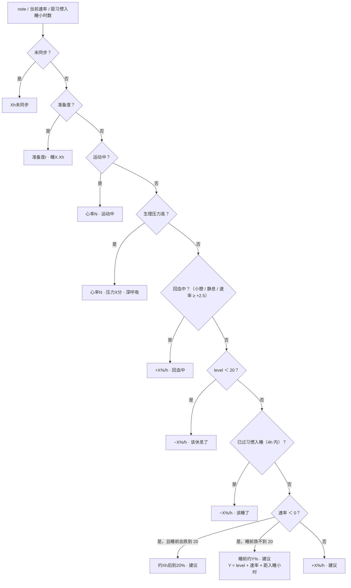

建议词：

| 条件 | 建议 |
|---|---|
| level ≥ 65 | 适合专注 |
| 45 ≤ level ＜ 65 | 适合轻任务 |
| level ＜ 45，距入睡 ≤ 2h | 宜早睡 |
| level ＜ 45，18 点前 | 宜小憩 |
| level ＜ 45，其它时间 | 宜放松 |

---

## 6. 周限

### 6.1 周期与总式

- 一周从**周六 12:00（系统时区）**开始，到下周六 12:00 重置。
- 预算 7 小时：把一周的透支折算成「负债小时」D。

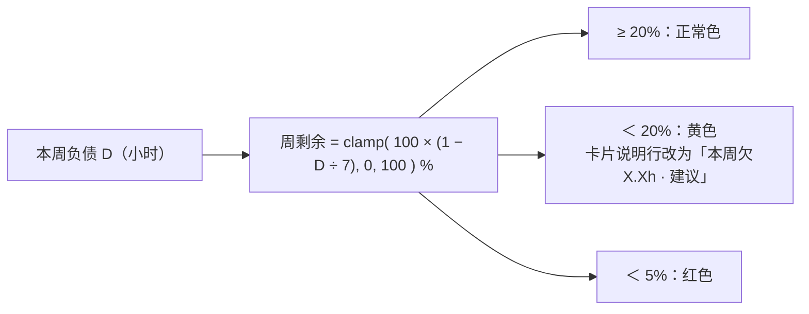

### 6.2 逐日账本

每天的负债减去当天的还款，结余**不能为负**。所以多睡只能还旧债，不能预存。

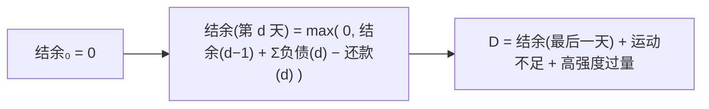

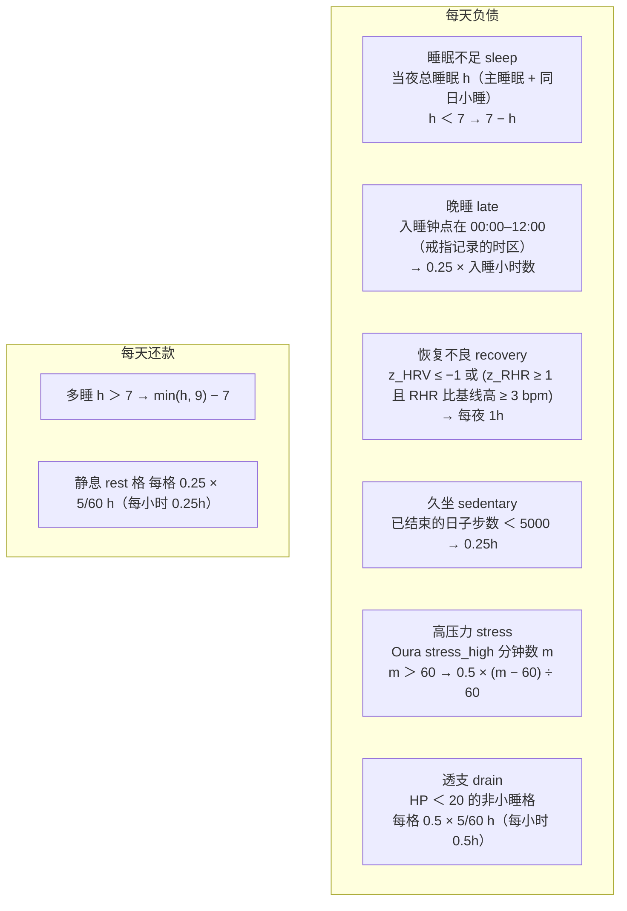

各项归属：

- 睡眠、晚睡、恢复不良：记在醒来那天；只算醒来时刻落在本周内的夜晚。
- 日汇总（步数、压力）：按 Oura 的 `day` 字段，周六整天都算新的一周。
- 5 分钟格：按格的开始时刻归日。

### 6.3 全周项：运动

按 WHO 成人标准：每周 150 分钟中等强度当量；高强度 1 分钟折算 2 分钟。

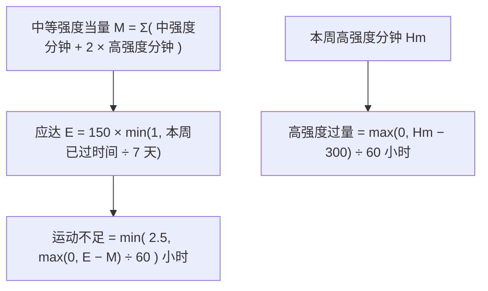

周初应达量很小，周中、周末逐步提高，所以不会一开周就背满 2.5h。

### 6.4 标准值一览

| 项 | 标准（普通成年人） | 折算 |
|---|---|---|
| 睡眠 | 每夜 7h | 少 1h 欠 1h；多睡最多按 9h 计 |
| 晚睡 | 00:00 前入睡 | 00:00 后每小时 0.25h |
| 运动不足 | 每周 150 分钟中等强度当量 | 缺 60 分钟欠 1h，封顶 2.5h |
| 高强度过量 | 每周 ≤ 300 分钟 | 超 60 分钟欠 1h |
| 久坐 | 每天 ≥ 5000 步 | 不足一天欠 0.25h |
| 高压力 | 每天 ≤ 60 分钟 | 超出每小时欠 0.5h |
| 透支 | HP ≥ 20% | HP 低于 20 的每小时欠 0.5h |
| 恢复不良 | HRV、静息心率在个人基线内 | 每夜欠 1h |
| 静息还款 | — | 每小时静息还 0.25h |

### 6.5 压力单位判定

Oura 文档写 `stress_high` 以秒计，实测数值都是 900 的倍数。

- **只有**全部行都 ≤ 1440 **且**至少有一个值不是 300 的倍数时，才当作分钟；其它情况一律按秒。
- 判定用本次拉取的全部行，不只看本周。
- 拿不准时按秒处理，算出的负债只会偏少，不会把平静的一周算成几十小时。

### 6.6 说明行与建议

- 负债最大的一项记为 `top`，对应的建议：

  | top | 建议 |
  |---|---|
  | sleep | 该补觉 |
  | late | 今晚早睡 |
  | exercise_low | 去动一动 |
  | sedentary | 多走走 |
  | exercise_high | 停练休息 |
  | stress | 放松一下 |
  | drain | 强制休息 |
  | recovery | 强制休息 |

- 周剩余 ＜ 20% 时，白天的卡片说明行改为「本周欠X.Xh · 建议」。
- 以下紧急说明优先，不会被周限覆盖：Xh未同步、准备度、运动中、生理压力高。

### 6.7 数据来源与缓存

- 睡眠、`daily_activity`、`workout` 和 `daily_stress` 每次都拉近 7 天。
- 本周已结束的日子：用当天的心率重放一遍 5 分钟格，结果缓存进 `server/hp_weekly_cache.json`，每天只算一次。
  - 补拉心率失败的那天不缓存，本轮按 0 计，下一轮重试。
- 今天的格直接用日 HP 本轮的重放结果。
- 周限计算出错只写日志，不影响日 HP 显示。

---

## 7. 卡片投影

`display_server.energy_to_subscription` 把能量项转成一张通用卡片，旧设备不用升级也能显示：

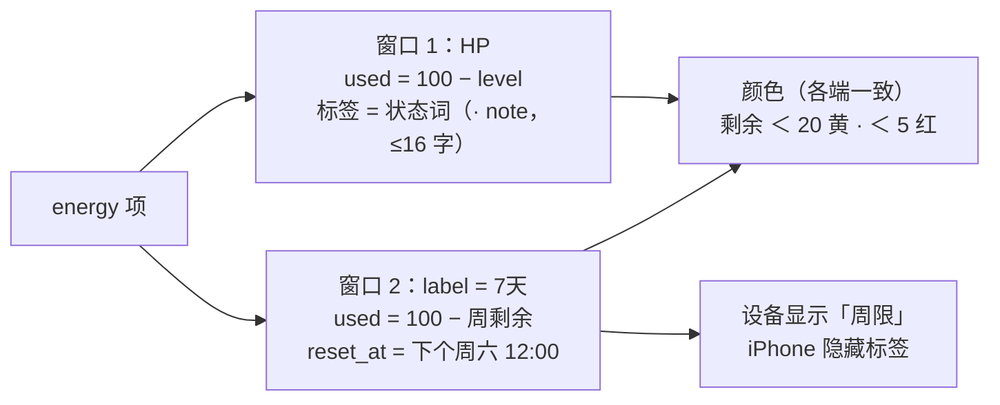

---

## 8. 参数表（`DEFAULT_PARAMS`）

| 参数 | 值 | 含义 |
|---|---|---|
| basal | 2.0 %/h | 清醒基础消耗 |
| k_act | 0.15 | TRIMP 负荷系数 |
| k_met | 1.5 | MET 负荷系数 |
| k_stress | 20.0 | 心率偏离 → 压力负荷 |
| theta_stress | 0.08 | 高出安静心率 8% 才算压力 |
| stress_cap | 8.0 %/h | 压力负荷上限 |
| theta_rest | −0.05 | 低于安静心率 5% 算静息 |
| rest_gain | 2.0 %/h | 静息抵消基础消耗 |
| tau_sleep | 4.2 h | 睡眠 / 小睡回血时间常数 |
| exp_load | 0.8 %/h | 未观测 / 未佩戴时的预期负荷 |
| trend_band | 2.5 %/h | 趋势判定阈值 |
| kappa | 1.0 | 全局负荷倍率 |

周限常量在 `hp_weekly.py` 顶部：BUDGET_H=7、SLEEP_NEED_H=7、SLEEP_CREDIT_MAX_H=9、LATE_WEIGHT=0.25、EXERCISE_MIN=150、EXERCISE_CAP_H=2.5、HIGH_MAX_MIN=300、STEPS_MIN=5000、SEDENTARY_H=0.25、STRESS_ALLOW_MIN=60、STRESS_WEIGHT=0.5、DRAIN_LEVEL=20、DRAIN_WEIGHT=0.5、RECOVERY_H=1、REST_CREDIT=0.25、RHR_MIN_DELTA=3、LOW_PERCENT=20。

---

## 9. 已知局限

- 日 HP 的说明行「压力X分」直接把 `stress_high` 当秒换算。`hp_usage.py` 的回测报告仍用旧规则判断单位（中位数 ＜ 1440 就当分钟），比周限的判定脆弱。
- 周的边界用系统时区；晚睡判定用戒指记录自带的时区。两者不同时（比如人在日本、戒指记录 +08:00），周六 12:00 指的是系统时区的 12:00。
- 静息（rest）的速率是 0，所以白天静坐只能停止掉血，不会回血；回血主要靠睡眠和小睡。
